<div align="center">



<a href="https://git.io/typing-svg">
  
</a>

<br/><br/>

<a href="https://personal-portfolio-five-liard-62.vercel.app"></a>
<a href="https://linkedin.com/in/gnandakishorereddy"></a>
<a href="https://dev.to/n9601"></a>
<a href="mailto:nandakishorereddyg@outlook.com"></a>
<a href="https://personal-portfolio-five-liard-62.vercel.app/Nandakishore_Reddy_CV.pdf"></a>

</div>


### `$ neofetch`

<p align="center">
<picture>
  <source media="(prefers-color-scheme: dark)" srcset="assets/neofetch-dark.svg"/>
  <source media="(prefers-color-scheme: light)" srcset="assets/neofetch-light.svg"/>
  
</picture>
</p>

<sub><p align="center">stats refresh daily via GitHub Actions</p></sub>


### `$ whoami`

```go
package main

type Engineer struct {
    Name      string
    Role      string
    Base      string
    Education []string
    Builds    []string
    Ships     []string
    OffClock  []string
}

var me = Engineer{
    Name: "Gadusatla Nandakishore Reddy",
    Role: "Software Engineer, Full-Stack & AI Automation @ Verge Scales",
    Base: "Hyderabad, IN (IST)",
    Education: []string{
        "B.Tech CSE @ VNR VJIET (2026 - present)",
        "Diploma CSE @ TRR, CGPA 9.18 / 10, top 1% of cohort",
    },
    Builds:   []string{"LSM-tree storage engines", "x86 kernels", "LLM pipelines"},
    Ships:    []string{"payroll", "order operations", "marketing intelligence"},
    OffClock: []string{"perf tuning", "custom Android ROMs", "music", "films", "photography"},
}
